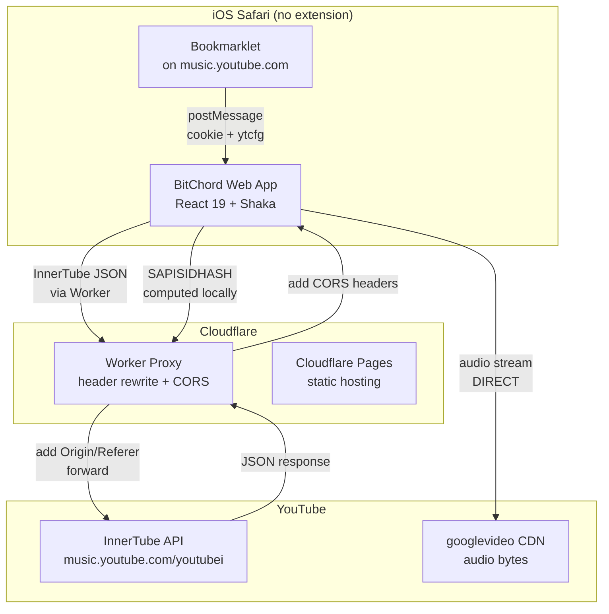

## Product Overview

BitChord adalah YouTube Music client yang saat ini hanya berjalan di Android (native Kotlin) dan desktop/web (dengan browser extension). Tujuan utama: memungkinkan BitChord berjalan di iOS Safari **tanpa signing, tanpa reinstall 7 hari, tanpa instalasi apapun** — pure web, dibuka via URL di browser.

Web app React 19 yang sudah ada di `web/` sudah lengkap (player, lyrics, search, browse, library), tetapi memerlukan browser extension untuk: (1) header rewrite untuk InnerTube API, (2) CORS bypass, (3) membaca cookie YouTube untuk sign-in. iOS Safari tidak mendukung extension.

## Core Features (Fase 1)

- **Anonymous YouTube Music playback di iOS Safari**: search, browse, play musik, lyrics — tanpa login, tanpa extension
- **YouTube Music sign-in di iOS Safari**: library, liked songs, history — user login manual di music.youtube.com, capture session via bookmarklet
- **Cloudflare Worker proxy**: menggantikan extension DNR rules untuk header rewrite dan CORS bypass pada InnerTube API (JSON only, audio bytes tetap direct dari CDN)
- **Bookmarklet auto-generated**: user klik "Install Bookmarklet", drag ke bookmark bar, lalu klik saat berada di music.youtube.com untuk capture session via `postMessage`
- **Client-side SAPISIDHASH**: komputasi signature di browser menggunakan Web Crypto API (sama seperti extension, tapi di page context)
- **Encrypted session storage**: cookie dan identity disimpan terenkripsi di IndexedDB, tidak pernah dikirim ke server

## Out of Scope (Fase 2+)

- Spotify integration (bookmarklet untuk sp_dc)
- Discord rich presence (bookmarklet untuk localStorage.token)
- Listen Together dari mobile browser
- PWA/offline support

## Tech Stack

- **Web app (existing)**: React 19 + Vite + TypeScript + Tailwind CSS v4 + Shaka Player + YouTube.js + TanStack Query + Zustand
- **Cloudflare Worker**: TypeScript, `wrangler.toml`, free tier 100K req/hari
- **Session storage**: IndexedDB (via `idb` library, already in dependencies) + Web Crypto API untuk encryption
- **Bookmarklet**: Vanilla JS string generated server-side (Vite env), executed on `music.youtube.com`, communicates via `window.opener.postMessage()`
- **SAPISIDHASH**: `crypto.subtle.digest('SHA-1')` — works in iOS Safari

## Implementation Approach

### Strategy: Worker proxy + Bookmarklet, sebagai fallback ketika extension missing

Web app yang sudah ada punya dua fetch path di `innertube.ts`:

- `simpleRequestFetch()` — anonymous InnerTube calls, currently relies on extension DNR untuk header rewrite
- `signedFetch()` — authenticated calls via `bridge.call('yt.fetch', {auth:true})`, extension baca cookie + compute SAPISIDHASH

**Worker proxy** menggantikan DNR rules: InnerTube request di-route ke Worker URL, Worker menambahkan `Origin`/`Referer`/`X-Origin` (port dari `rules.ts:impersonate()`), forward ke YouTube, return dengan CORS headers. Audio bytes tetap direct dari `googlevideo.com` CDN (tidak lewat Worker).

**Bookmarklet** menggantikan `chrome.cookies` API: user login di `music.youtube.com` di tab terpisah, klik bookmarklet yang baca `ytcfg` + `document.cookie` (port dari `YTCFG_PROBE` di Android `YtMusicLoginScreen.kt`), kirim via `postMessage` ke web app. Web app simpan di IndexedDB, compute SAPISIDHASH locally (port dari `ytAuth.ts:sapisidHash()`).

### Key Technical Decisions

1. **Worker hanya proxy API JSON, bukan audio**: Compute budget constraint dari design doc. InnerTube JSON ~5-50KB per request. Audio stream direct dari googlevideo CDN. Worker free tier 100K req/hari cukup untuk penggunaan pribadi.

2. **Bookmarklet, bukan OAuth**: YouTube Music InnerTube API pakai cookie-based session dengan SAPISIDHASH, bukan OAuth standard. OAuth Google tidak menghasilkan cookie yang dibutuhkan. Bookmarklet adalah satu-satunya cara di pure web untuk mendapatkan cookie dari domain lain — sama filosofi dengan Android WebView + CookieManager.

3. **Three-layer fetch dispatch di innertube.ts**:

- Extension present → existing `simpleRequestFetch` / `signedFetch` via bridge (unchanged)
- Extension missing, Worker configured → `workerFetch` (Worker adds headers)
- Extension missing, Worker missing → current behavior (CORS will fail, show install prompt)

4. **SAPISIDHASH di client-side**: `crypto.subtle.digest('SHA-1')` bekerja di semua browser termasuk iOS Safari. Port langsung dari `ytAuth.ts:65-70`. Secret (SAPISID cookie value) didapat dari bookmarklet, disimpan di IndexedDB.

5. **Backward compatibility**: Desktop dengan extension tetap bekerja seperti sebelumnya. Worker+bookmarklet hanya aktif sebagai fallback.

### Performance & Reliability

- **Worker latency**: +20-50ms per InnerTube call (Cloudflare edge). Acceptable — InnerTube responses cached by TanStack Query (staleTime 10min).
- **No N+1**: Worker hanya untuk InnerTube `youtubei/v1/*` calls, bukan per-track. Audio direct dari CDN.
- **Session persistence**: IndexedDB bertahan across tab reloads. Cookie YouTube session berlaku ~2 tahun (SAPISID) atau berotasi (SIDCC). App perlu re-capture kalau expired.
- **Audio di Safari**: Engine sudah handle — Opus (itag 251) kalau `MediaSource.isTypeSupported`, fallback AAC (itag 140) untuk Safari. Code sudah ada di `engine.ts:106-107`.

### Security

- `postMessage` handler memvalidasi `event.origin` — hanya terima dari `https://music.youtube.com`
- Session di-encrypt dengan Web Crypto API (`AES-GCM`) sebelum disimpan di IndexedDB
- Worker tidak log request bodies (no PII)
- Cookie tidak pernah dikirim ke Worker URL sebagai parameter — dikirim sebagai HTTP header yang sudah di-sign

## Architecture Design



### Fetch dispatch logic (innertube.ts)

```
getInnertube() → create(fetch)
  fetch = 
    extension present? → simpleRequestFetch (DNR rules, unchanged)
    worker configured? → workerFetch (route through Worker URL)
    else → simpleRequestFetch (will fail CORS, show prompt)

getSignedInnertube() → create(signedFetch)  
  signedFetch =
    extension present? → bridge.call('yt.fetch', {auth}) (unchanged)
    bookmarklet session? → workerSignedFetch (SAPISIDHASH locally, route through Worker)
    else → throw 'not signed in'
```

### Auth state union (useYtAuth.ts)

```
readAuth() =
  extension present + yt.auth? → bridge.call('yt.authState') (unchanged)
  bookmarklet session in IndexedDB? → buildYtAuthState(session) (new)
  else → SIGNED_OUT
```

## Directory Structure Summary

Modifikasi menambahkan Worker proxy baru dan bookmarklet auth layer, serta mengubah fetch routing dan query gating di web app yang sudah ada.

```
BitChord/
├── web/
│   ├── worker/                         # [NEW] Cloudflare Worker proxy
│   │   ├── src/
│   │   │   └── index.ts                # [NEW] Worker entry: header rewrite + CORS for InnerTube
│   │   ├── wrangler.toml               # [NEW] Cloudflare Worker config (routes, vars)
│   │   ├── package.json                # [NEW] Worker dependencies + deploy scripts
│   │   └── tsconfig.json               # [NEW] Worker TypeScript config
│   ├── app/
│   │   ├── src/
│   │   │   ├── auth/                   # [NEW] Bookmarklet session capture
│   │   │   │   ├── bookmarklet/
│   │   │   │   │   ├── generator.ts    # [NEW] Generates bookmarklet JS string with app origin
│   │   │   │   │   ├── receiver.ts     # [NEW] postMessage listener, validates origin music.youtube.com
│   │   │   │   │   ├── storage.ts      # [NEW] Encrypted session storage in IndexedDB (AES-GCM via Web Crypto)
│   │   │   │   │   ├── sapisidHash.ts  # [NEW] SAPISIDHASH computation (port from extension/lib/ytAuth.ts:65-70)
│   │   │   │   │   └── types.ts        # [NEW] CapturedSession type (matching Android WebSession.kt)
│   │   │   │   ├── SignInPage.tsx      # [NEW] Bookmarklet install instructions + session status UI
│   │   │   │   └── useBookmarkletAuth.ts # [NEW] React hook: reads/writes bookmarklet session, provides YtAuthState
│   │   │   ├── config.ts               # [MODIFY] Add workerUrl config from VITE_WORKER_URL env
│   │   │   ├── playback/
│   │   │   │   └── youtube/
│   │   │   │       └── innertube.ts    # [MODIFY] Add workerFetch + workerSignedFetch fallback paths
│   │   │   ├── extension/
│   │   │   │   └── useYtAuth.ts        # [MODIFY] readAuth(): add bookmarklet auth path when extension missing
│   │   │   ├── data/music/
│   │   │   │   └── queries.ts          # [MODIFY] useYouTubeReady(): ready when Worker configured OR extension present
│   │   │   ├── shell/
│   │   │   │   └── AppShell.tsx        # [MODIFY] Mobile banner: allow app usage when Worker configured, not "Get the App"
│   │   │   ├── lib/
│   │   │   │   └── platform.ts         # [MODIFY] Add isIOS() and hasWorkerProxy() helpers
│   │   │   ├── components/music/
│   │   │   │   └── States.tsx          # [MODIFY] Add NeedsBookmarklet variant for iOS without extension
│   │   │   └── routes.tsx              # [MODIFY] Add /sign-in route for bookmarklet setup page
│   │   └── vite.config.ts              # [MODIFY] Add VITE_WORKER_URL env var support
│   └── pnpm-workspace.yaml             # [MODIFY] Add worker/ to workspace
```

## Key Code Structures

### CapturedSession type (matching Android's `WebSession.kt:CapturedSession`)

```typescript
// web/app/src/auth/bookmarklet/types.ts
export interface CapturedSession {
  cookie: string;           // document.cookie from music.youtube.com
  pageId: string | null;    // DELEGATED_SESSION_ID (brand channel)
  dataSyncId: string | null; // DATASYNC_ID
  authUser: string | null;  // SESSION_INDEX
  visitorData: string | null;
  clientVersion: string | null;
  loggedIn: boolean;
  capturedAt: number;       // Date.now() — for expiry checks
}
```

### Worker request contract (Worker ↔ Web App)

```typescript
// Anonymous: web app sends InnerTube request to Worker URL
// Worker adds Origin/Referer/X-Origin, forwards to YouTube
// POST https://worker.bitchord.workers.dev/youtubei/v1/...
// Body: text/plain (same "simple request" pattern as simpleRequestFetch)
// Response: YouTube JSON + Access-Control-Allow-Origin: *

// Signed: same Worker URL, but web app adds headers before sending:
// Authorization: SAPISIDHASH <ts>_<hash>
// X-Goog-AuthUser: <authUser>
// X-Goog-PageId: <pageId> (if brand channel)
// Cookie: <captured cookie>
// Worker passes these through + adds Origin/Referer
```

### SAPISIDHASH (port from `web/extension/lib/ytAuth.ts:65-70`)

```typescript
// web/app/src/auth/bookmarklet/sapisidHash.ts
export async function sapisidHash(secret: string, origin: string): Promise<string> {
  const timestamp = Math.floor(Date.now() / 1000);
  const digest = await crypto.subtle.digest('SHA-1', 
    new TextEncoder().encode(`${timestamp} ${secret} ${origin}`));
  const hex = [...new Uint8Array(digest)].map((b) => 
    b.toString(16).padStart(2, '0')).join('');
  return `SAPISIDHASH ${timestamp}_${hex}`;
}
```

## Implementation Notes

### Grounded execution details

1. **Worker port dari `rules.ts:impersonate()`**: Fungsi `impersonate(origin)` di extension (`rules.ts:32-34`) menset `Origin`, `Referer`, `X-Origin`. Worker melakukan hal yang sama: terima request, set header ini, forward ke YouTube. Port langsung, tidak ada logic baru.

2. **Bookmarklet port dari `YTCFG_PROBE`**: Android `YtMusicLoginScreen.kt:180-200` sudah punya JavaScript probe yang baca `window.ytcfg.get()`. Bookmarklet adalah versi yang sama, dibungkus `javascript:(function(){...})()` dan kirim via `postMessage` alih-alih `evaluateJavascript` callback.

3. **SAPISIDHASH port dari `ytAuth.ts:65-70`**: Exact same code, sudah pakai `crypto.subtle.digest` yang bekerja di iOS Safari. Signing cookies: `SAPISID`, `__Secure-3PAPISID`, `__Secure-1PAPISID` (dari `ytAuth.ts:20`). Parse dari captured cookie string.

4. **`useYouTubeReady()` gating**: Saat ini `ready = extension.state === 'present' && capabilities.includes('yt')`. Tambah: `ready = (extension present dengan 'yt') || (workerUrl configured)`. Ini membuka semua query hooks (`useHome`, `useSearch`, dll) di iOS.

5. **`AppShell.tsx` banner**: Saat ini `if (mobile) banner = "Get the App"`. Ubah: `if (mobile && !hasWorkerProxy()) banner = "Get the App"`. Kalau Worker configured, mobile tetap pakai app tanpa banner.

6. **`signedFetch` dispatch**: Saat ini throw `Error('Signed-in requests need the BitChord extension')` kalau bridge null. Tambah fallback: kalau bookmarklet session ada di IndexedDB, gunakan `workerSignedFetch` (compute SAPISIDHASH locally, route through Worker dengan auth headers).

### Performance notes

- Worker adds ~20-50ms per InnerTube call. TanStack Query caches 10 min (staleTime di `queries.ts:41`). Home feed = 1 call. Search = 1 call. Album = 1 call. Tidak ada N+1.
- Audio bytes tidak lewat Worker. Shaka Player fetch langsung dari `googlevideo.com`. Worker hanya untuk `youtubei/v1/*` JSON.
- BotGuard (`bgutils-js`) berjalan di page context — tidak butuh Worker atau extension. Sudah ada di dependencies.

### Logging

- Worker: log hanya URL path + status code, no request/response bodies (no PII/cookies). Rate-limit logs via `console.log` sampling.
- Web app: reuse existing `trackLog` untuk auth state changes dan Worker fallback activation.

### Blast radius control

- **Extension flow unchanged**: Desktop dengan extension tetap pakai `simpleRequestFetch` + `signedFetch` via bridge. Worker+bookmarklet hanya fallback.
- **`VITE_WORKER_URL` optional**: Kalau tidak diset, web app behave seperti sebelumnya (extension required). Build tidak gagal tanpa Worker URL.
- **`VITE_PARTY_SERVER_URL`**: Saat ini build gagal tanpa ini. Pertahankan untuk desktop, tapi untuk mobile-only build, bisa di-set ke dummy atau dibuat optional.

## Agent Extensions

### SubAgent

- **code-explorer**: Use for deep verification of all fetch call sites, query gating patterns, and auth state propagation across the codebase before implementation begins. Expected outcome: Complete map of every file that reads `extension.state` or calls `getBridge()`, ensuring no auth or fetch path is missed during modification.